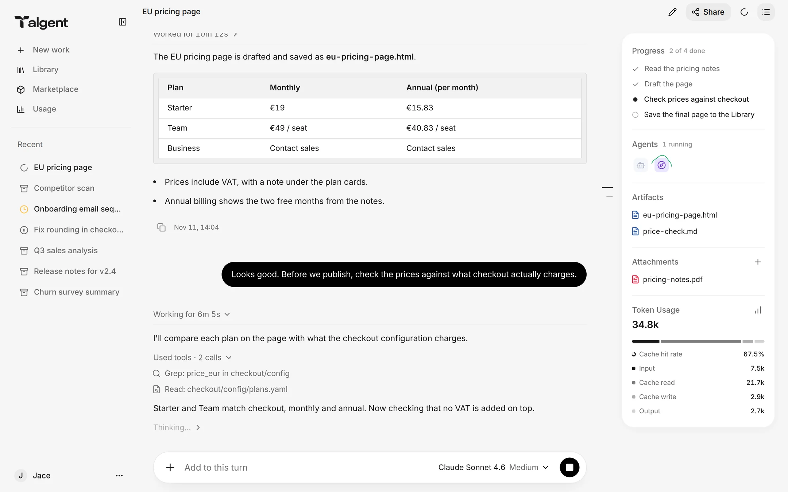
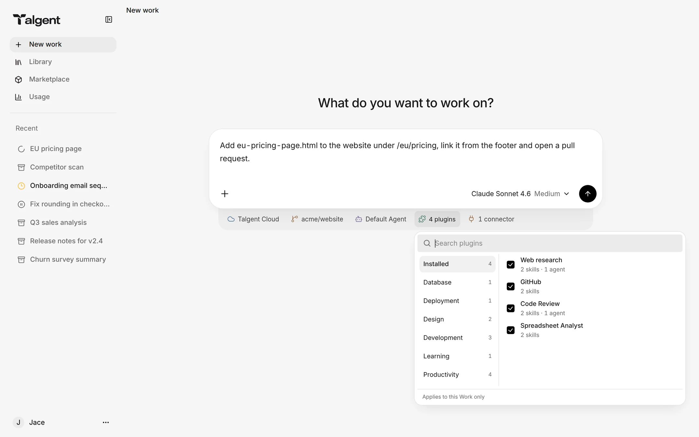
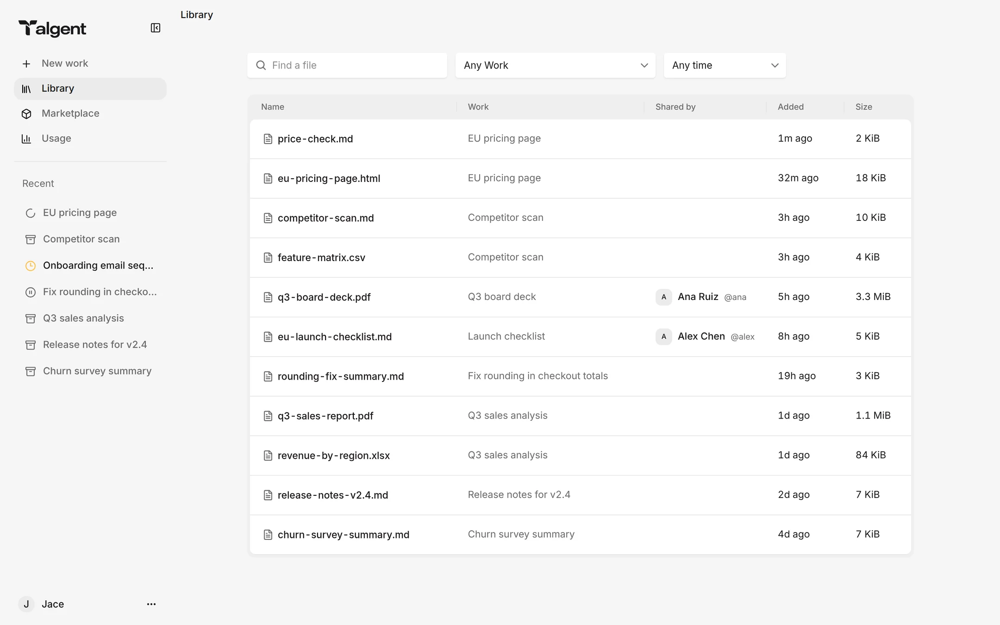
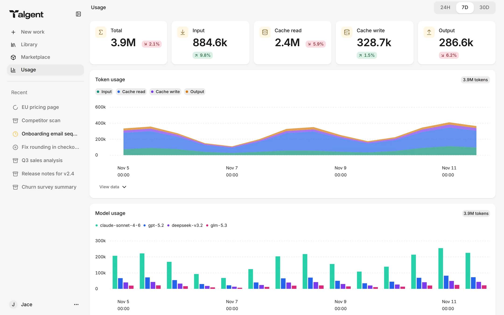
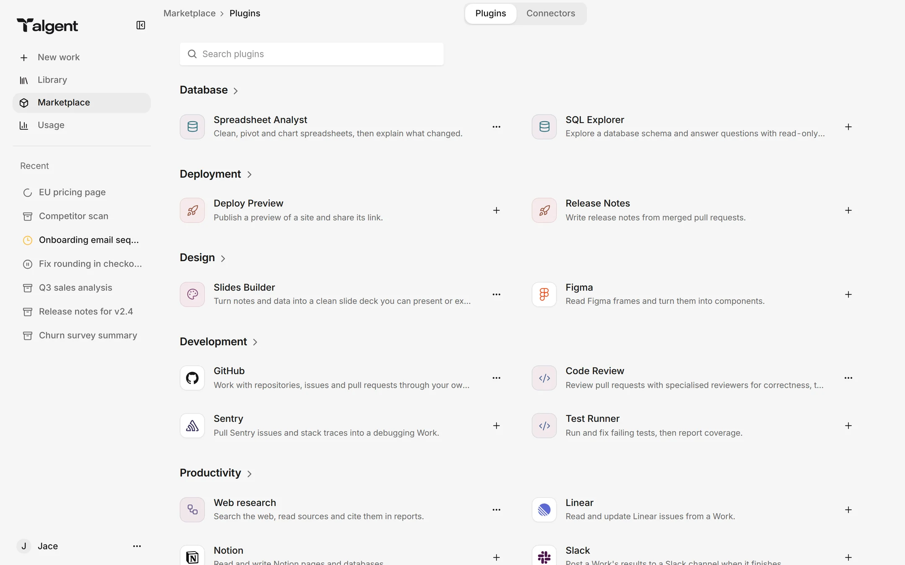
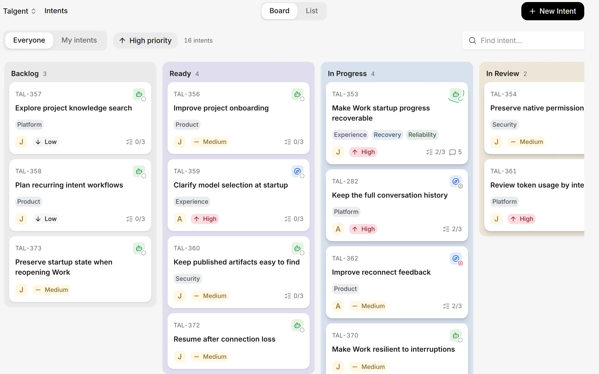
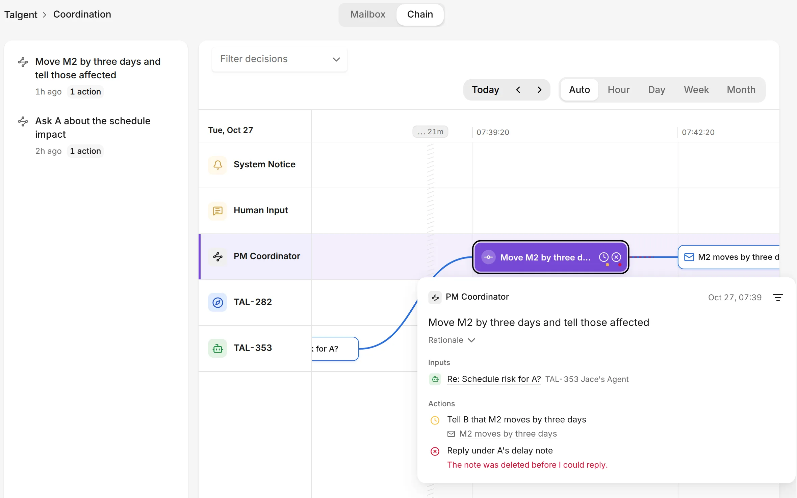
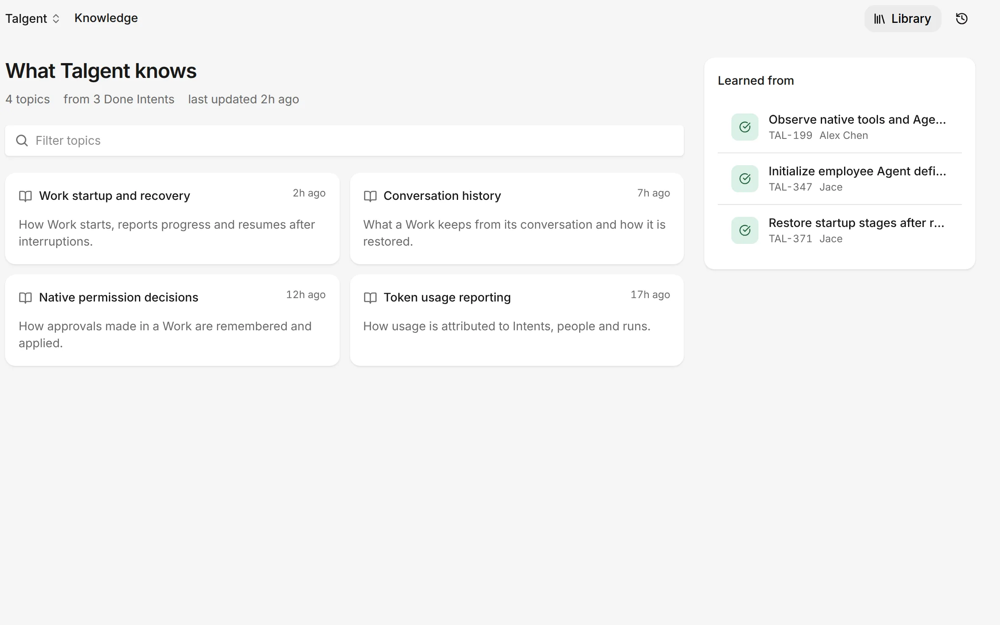

<picture>
  <source media="(prefers-color-scheme: dark)" srcset="docs/assets/logo-dark.png">
  
</picture>

### Your own Agent, ready for real work.

Open-source managed agents you host yourself. Run every Work in a cloud sandbox, or on your own machine.

[Website](https://talgent.work) · [Get started](#get-started) · [Documentation](#documentation) ·
[Releases](https://github.com/talgent-work/workbench/releases) · [Report a bug](https://github.com/talgent-work/workbench/issues/new/choose)

Talgent Workbench gives everyone an AI Agent of their own. Start a Work, hand it files, follow
what it does as it happens and get the results back. Run several Works at once, and do more than
you could alone.

Workbench is a managed agent platform that runs in your own environment instead of a vendor's
cloud. It hosts every Agent's runtime for you: a sandbox for each Work, sessions that resume where
they stopped, credentials kept out of reach, access granted per person and every run's cost in
sight.

## Two ways to run a Work

Each time you start a Work, choose where it runs: hosted in Workbench's cloud, or on a computer of
your own that Workbench manages. Everything else stays the same: the live conversation, the Library,
Usage, Plugins and sharing.

| | Cloud (hosted) | Managed Computer |
|---|---|---|
| **Where it runs** | In a fresh sandbox on your Workbench's Kubernetes cluster | On your own Mac, Linux or Windows machine, connected with Talgent Computer |
| **Best for** | Work that should run any time, with nothing to set up and no machine left on | Work that needs the files, tools and apps already on your machine |
| **Isolation** | Its own sandbox, cut off from your private network; credentials and model keys never enter it | You choose how much the Agent may do there, and can confine it to the operating system's sandbox on macOS and Linux |
| **Setup** | None for you; the deployment provides it | Install `@talgent/computer` from npm and connect the machine from your Computers page. It needs only an outbound connection and keeps itself up to date |

## What you can do

**Hand work to your Agent.** Describe the task, attach files, pick a repository, a model and the
Plugins it needs. Steer it while it runs, stop it, and pick it up later exactly where it left off.

**Watch it work.** The conversation streams live: what the Agent is thinking, the tools it calls,
its plan and its progress. Share a Work with colleagues so they can follow along, read-only, until
you revoke it.

**Keep everything it made.** Reports, pages, spreadsheets and decks the Agent publishes land in
your Library, next to what others have shared with you. Office documents, PDFs and images preview
in the browser.

**Extend it from the Marketplace.** Add the Plugins (Skills and specialist Agents) and Connectors
your Workbench offers, and authorize your own GitHub account for the repositories a Work checks out.

**See what it costs.** Token use over time, by kind and by model, and the Works that used the most.

<table>
  <tr>
    <td width="50%">
Start a Work with what it needs
</td>
    <td width="50%">
Everything your Agents made, in your Library
</td>
  </tr>
  <tr>
    <td width="50%">
Usage down to the token
</td>
    <td width="50%">
Plugins and Connectors from the Marketplace
</td>
  </tr>
</table>

Screenshots show sample data.

## Why Workbench

- **Your environment.** Deploy Workbench on your own Kubernetes cluster and run Works there or on
  your own computers. Your files and results stay with you.
- **Isolated by default.** Every cloud Work runs in its own sandbox, cut off from your private
  network, and on your own computer you decide how far the Agent may reach. Credentials and model
  keys never enter a Work.
- **Any model.** Offer the models you choose: Claude, DeepSeek, Qwen, Kimi, GLM, MiniMax, or any
  other vendor with an Anthropic-compatible API, each with its own key. People pick one when they
  start a Work.
- **Yours alone.** Each Work, file and share belongs to the person who made it and reaches only
  who it is meant for.
- **Open source.** Apache-2.0. Read and audit the code that runs your Agents, with no lock-in to
  one vendor's cloud or model.

## From every person to the whole company: Talgent Orchestra

Workbench gives every person an Agent of their own. When work outgrows one person, **Talgent
Orchestra**, built on Workbench, brings those Agents together across a company's projects, so
every change reaches the people it affects and finished work becomes company knowledge.

- **Goals with an owner.** Every goal of a project on one board, with its owner, its priority and
  the Agents working on it.
- **A coordinator that keeps every Agent in step.** It knows how the goals depend on each other.
  When one changes, the owners of the others hear about it, and their Agents adjust.
- **Decisions you can trace.** Every decision the coordinator makes is on a timeline, with what it
  rested on, what it did and how that went.
- **Knowledge that compounds.** Finished work becomes pages the whole project learns from, every
  statement traced to the work it came from.

Say Marketing's Agent moves checkout to show prices in EUR. The coordinator sees that invoices and
the Q4 report depend on it, and asks Billing and Finance. Billing needs two more days, so the launch
moves by two days and every owner is told. The EU pricing rules are kept for the next time.

<table>
  <tr>
    <td width="50%">
Every decision, with its inputs and outcomes
</td>
    <td width="50%">
What the project has learned, and from where
</td>
  </tr>
</table>

**[Discover Talgent Orchestra at talgent.work →](https://talgent.work)**

## Get started

- **Deploy Workbench** on your Kubernetes cluster with the [self-hosting guide](docs/self-hosting.md).
- **Connect your machine** with Talgent Computer: install `@talgent/computer` from npm and follow
  the Computers page of your Workbench (macOS, Linux and Windows).
- **Talk to us** about Talgent at [talgent.work](https://talgent.work).

## Documentation

| Topic | Where |
|---|---|
| Deploying on Kubernetes | [Self-hosting guide](docs/self-hosting.md) |
| Every setting of every process | [Configuration reference](docs/configuration.md) |
| Processes, stores and repository layout | [Architecture](docs/architecture.md) |
| Building, testing and releases | [Development](docs/development.md) |
| Talgent Computer and its gateway | [Talgent Computer protocol](docs/computer-protocol.md) |

## Contributing

Report bugs and request features as [GitHub issues](https://github.com/talgent-work/workbench/issues/new/choose);
the forms ask for what you did, what you expected, what happened, and the release you run. Report
security vulnerabilities privately, as [SECURITY.md](SECURITY.md) describes. The project does not
accept outside pull requests.

## License

Apache License 2.0; see [LICENSE](LICENSE).
